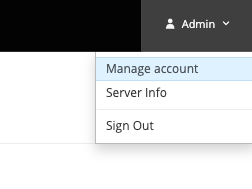
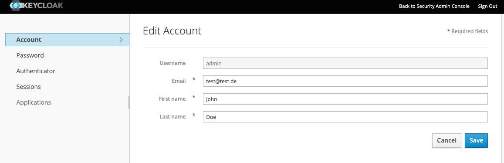
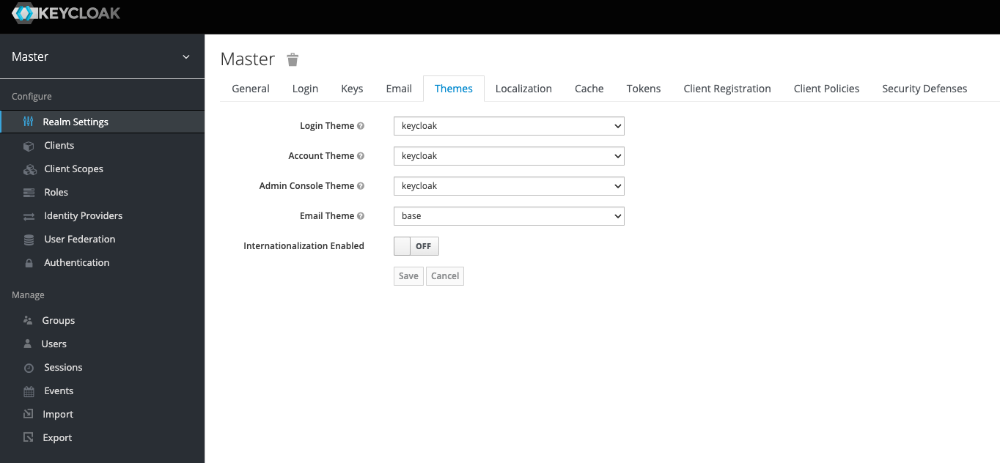
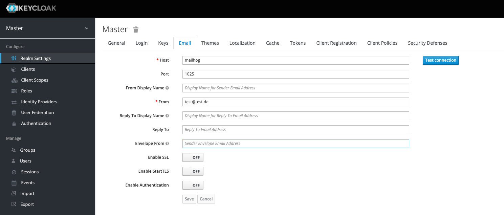

# Keycloak SPI to send emails with attachment

## getting started

```shell
make build
make start
```

visit [http://localhost:8080/auth/admin](http://localhost:8080/auth/admin). enter:

* username: admin
* password: admin

add an email to the admin account:  



Go back to the admin area.  
Change the e-mail theme to base


Go to the email settings and enter config for mailhog


click "test connection".

The mail client running on [http://localhost:8025](http://localhost:8025) should list a test-mail with the pdf
attachment.

## configuration for your keycloak

* You need to mount or copy the built jar file into `/opt/jboss/keycloak/standalone/deployments/` like it's done in
  the [Dockerfile](./Dockerfile).
* You need to insert the following code into your standalone-ha.xml file
```xml
<spi name="emailSender">
    <default-provider>emailwithattachment</default-provider>
    <provider name="emailwithattachment" enabled="true"></provider>
</spi>
```
## adding attachments

Attachments are declared directly in the **HTML** email template with a special comment, one comment per file:

```html
<html>
<body>
${kcSanitize(msg("emailTestBodyHtml",realmName))?no_esc}
<!-- !attach:files/test.pdf -->
<!-- !attach:files/another_test.pdf -->
</body>
</html>
```

* The path is relative to the `resources` directory of your email theme, e.g.
  [data/keycloak/themes/base/email/resources/](./data/keycloak/themes/base/email/resources/) — so the example above
  attaches `resources/files/test.pdf`.
* Only the HTML template is scanned. Markers in the text template (`text/*.ftl`) are ignored, and emails without an
  HTML body never get attachments.
* The attachment's file name is the last segment of the path. Its `Content-Type` is derived from the file extension
  (e.g. `.pdf` → `application/pdf`); unknown extensions are sent as `application/octet-stream`.
* If a file can't be found, a warning (`Attach stream is null: …`) is logged and the email is sent without that
  attachment.
* The comment stays in the HTML body. Mail clients don't display it, but it is visible in the message source.

See [email-test.ftl](./data/keycloak/themes/base/email/html/email-test.ftl) for a working example.
